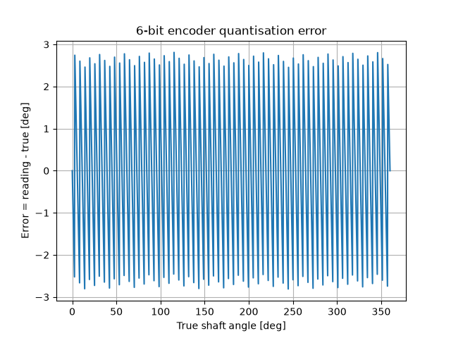
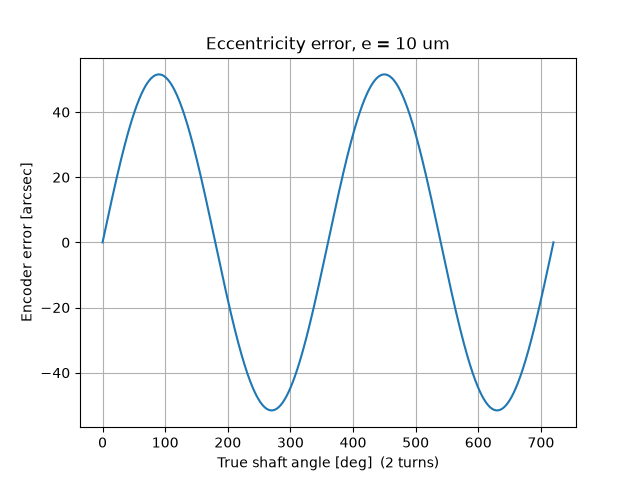
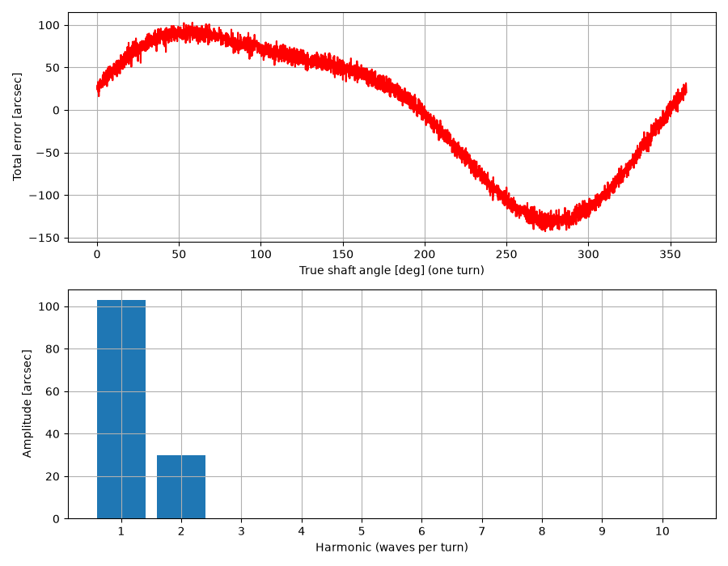

# Motion Control Validation Lab

Self-study lab on how a **rotary encoder is validated** in a motion-control system:
how fine it can resolve an angle, which mechanical errors make it read wrong, and how
those errors are separated and reported. Every step is a small Python script that
prints the key numbers and plots the result.

> **Status:** simulation / learning project. The error signals are modelled in Python
> (sine waves + random noise), not measured on a real test bench yet.

---

## Why this project

In motion control (robot joints, rotary tables, servo axes), the encoder is the "eye"
of the position loop. If it reports the wrong angle, the controller drives the axis to
the wrong place. A validation engineer has to answer three questions:

1. **Resolution:** what is the smallest angle the encoder can report?
2. **Accuracy:** how far is the reading from the true angle, and why?
3. **Reporting:** how do you turn a measured error curve into numbers someone can act on?

This lab goes through those questions one step at a time.

---

## Repository structure

```
motion-control-validation-lab/
├── encoder_basics.py          # Step 1: resolution + quantisation error
├── lesson2_accuracy.py        # Step 2: eccentricity error (disc off-centre)
├── lesson_2_total_error.py    # Step 3: combine error sources into one measured curve
├── lesson_2_fft.py            # Step 4: split the measured curve back into harmonics (FFT)
└── results/
    ├── Basics.png             # true angle vs. encoder reading
    ├── quantissation.png      # quantisation error (sawtooth)
    ├── eccentricity.png       # eccentricity error over 2 turns
    ├── total_error.png        # each error source + total
    └── fft.png                # total error + harmonic spectrum
```

---

## How to run

Requirements: Python 3, `numpy`, `matplotlib`.

```bash
pip install numpy matplotlib

python encoder_basics.py
python lesson2_accuracy.py
python lesson_2_total_error.py
python lesson_2_fft.py
```

Each script prints its results to the console and opens the plots. The figures in
`results/` were saved from these plots.

---

## Step 1: Resolution and quantisation (`encoder_basics.py`)

**Question:** how small is one encoder step?

An N-bit absolute encoder splits one turn into 2^N steps.

| Encoder | Steps per turn | One step [deg] | One step [arcsec] |
|---|---|---|---|
| 12-bit | 4,096 | 0.087891 | 316.41 |
| 19-bit | 524,288 | 0.000687 | **2.47** |

For a feel of the size: one 19-bit step moves the tip of a **1 m arm by about 12 µm**.

To *see* what the steps do, the script uses a very coarse 6-bit encoder (5.625° per step)
and rounds a smooth "true" angle to whole steps.


The difference (reading − true) is the **quantisation error**: a sawtooth between
−½ step and +½ step (here about ±2.8°), repeating every step.



**Takeaway:** resolution sets a floor for the error, but it is not the same as accuracy.
A 19-bit encoder can resolve 2.47 arcsec and still be wrong by much more because of
mechanics (next step).

---

## Step 2: Eccentricity error (`lesson2_accuracy.py`)

**Question:** what happens if the code disc is mounted slightly off-centre?

If the disc centre is offset by **e** from the shaft axis and the read head sits at radius
**R**, the angle error is a sine wave with **one period per revolution** and amplitude

```
Δθ ≈ e / R   [rad]
```

Values used in the script: e = 10 µm, R = 0.02 m (20 mm).

| Result | Value |
|---|---|
| Error amplitude | 0.0005 rad = **103.1 arcsec** |
| Compared with the 19-bit step | about **42 ×** larger |



**Takeaway:** a 10 µm mounting error, far smaller than a human hair, is already about
42 times bigger than the encoder's resolution. Mechanical mounting dominates accuracy.

---

## Step 3: Total error from several sources (`lesson_2_total_error.py`)

**Question:** what does a test bench actually see?

A real measurement never shows one clean error. The script builds the curve a test bench
would record over two turns by adding three sources (in arcsec):

| Source | Model | Signature |
|---|---|---|
| Eccentricity | 103 · sin(θ) | 1 wave per turn |
| Misalignment | 30 · sin(2θ + 1.0) | 2 waves per turn |
| Noise | Gaussian, σ = 5 | random |

(103 arcsec is the eccentricity amplitude from Step 2.)

The number a validation engineer reports first is the **peak-to-peak total error**:

| Result | Value |
|---|---|
| Peak-to-peak total error | **242.4 arcsec** |


**Takeaway:** the measured curve (red) mixes everything. From the total alone you cannot
tell how much comes from which cause, which is the problem Step 4 solves.

---

## Step 4: Separating the causes with an FFT (`lesson_2_fft.py`)

**Question:** given only the measured total error over one turn, can we find out which
mechanical problems caused it?

Each mechanical cause repeats a fixed number of times per revolution, so it shows up as
its own **harmonic**. An FFT over exactly one turn (4,096 samples) gives the amplitude of
each harmonic:

| Harmonic | Waves per turn | Amplitude found [arcsec] | Model input [arcsec] | Likely cause |
|---|---|---|---|---|
| H1 | 1 | **102.9** | 103 | Eccentricity |
| H2 | 2 | **29.8** | 30 | Misalignment / tilt |
| H3 | 3 | 0.1 | — | (noise only) |
| H4 | 4 | 0.1 | — | (noise only) |
| H5 | 5 | 0.3 | — | (noise only) |



**Takeaway:** the FFT recovers the two mechanical errors almost exactly, even with noise
on top. In practice this tells you *what to fix*: a large H1 means re-centre the disc, a
large H2 means check the mounting alignment.

---

## Summary of the process

```
resolution  →  one mechanical error  →  several errors mixed  →  separate them again
 (Step 1)          (Step 2)                  (Step 3)                 (Step 4)
```

| What | Number |
|---|---|
| 19-bit resolution | 2.47 arcsec |
| Eccentricity error (e = 10 µm, R = 20 mm) | 103.1 arcsec amplitude |
| Total modelled error (2 turns) | 242.4 arcsec peak-to-peak |
| FFT recovery of H1 / H2 | 102.9 / 29.8 arcsec (inputs 103 / 30) |

## What I learned

- Resolution and accuracy are different things; mechanics usually limit accuracy.
- Simple geometry (e / R) predicts the eccentricity error before anything is measured.
- An error curve over one revolution is best read in the frequency domain: each
  harmonic points to a physical cause.
- Report clear numbers (peak-to-peak, per-harmonic amplitudes), not only plots.

## Notes and next steps

- Next: apply the same analysis to real measured encoder data, and add a fitted error
  correction (subtract the H1/H2 sine waves) to show how much accuracy improves.

## Tools

Python · NumPy · Matplotlib

## Author

Ajay Arjun Mannolkar ([@technolkar](https://github.com/technolkar)) · Portfolio: https://technolkar.github.io
