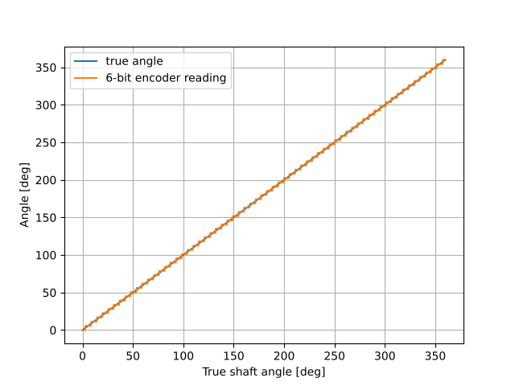
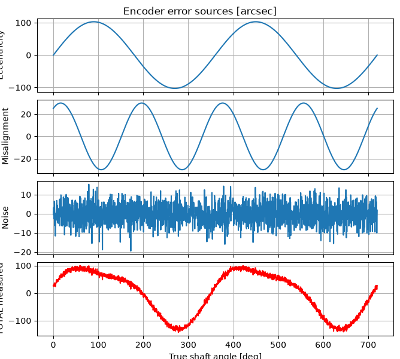
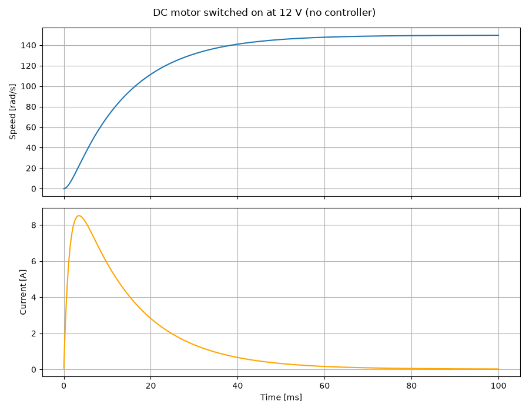
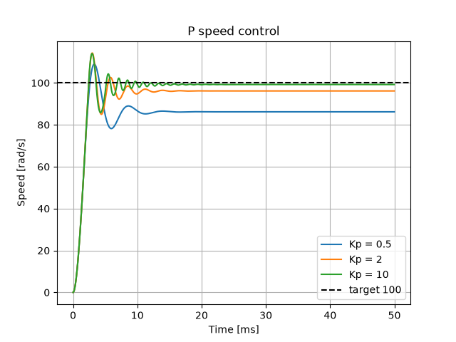
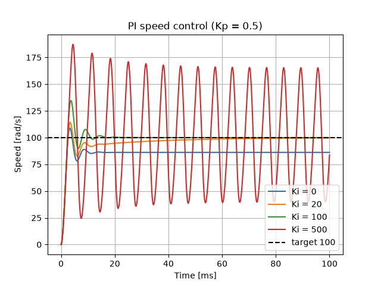
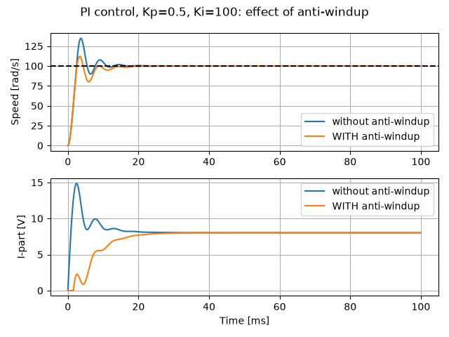
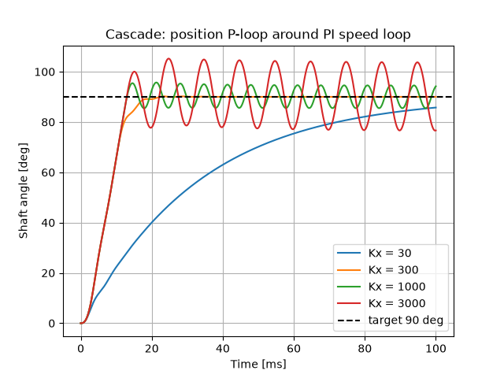

# Motion Control Validation Lab

Self-study lab on how a **rotary encoder is validated** in a motion-control system:
how fine it can resolve an angle, which mechanical errors make it read wrong, and how
those errors are separated and reported. Every step is a small Python script that
prints the key numbers and plots the result.

> **Status:** simulation / learning project. The error signals are modelled in Python
> (sine waves + random noise) and the motor in Steps 5–10 is a simulated model; nothing
> is measured on a real test bench yet.

---

## Why this project

In motion control (robot joints, rotary tables, servo axes), the encoder is the "eye"
of the position loop. If it reports the wrong angle, the controller drives the axis to
the wrong place. A validation engineer has to answer three questions:

1. **Resolution:** what is the smallest angle the encoder can report?
2. **Accuracy:** how far is the reading from the true angle, and why?
3. **Reporting:** how do you turn a measured error curve into numbers someone can act on?

This lab goes through those questions one step at a time (Steps 1–4). It then moves from
the sensor to the control loop it feeds: a DC motor model, P and PI speed control,
anti-windup, a PASS/FAIL step-response test and a cascade position loop (Steps 5–10).

---

## Repository structure

```
motion-control-validation-lab/
├── encoder_basics.py          # Step 1: resolution + quantisation error
├── lesson2_accuracy.py        # Step 2: eccentricity error (disc off-centre)
├── lesson_2_total_error.py    # Step 3: combine error sources into one measured curve
├── lesson_2_fft.py            # Step 4: split the measured curve back into harmonics (FFT)
├── lesson3_motor_open_loop.py # Step 5: DC motor model, no controller
├── lesson3_p_control.py       # Step 6: P speed control
├── lesson3_pi_control.py      # Step 7: PI speed control
├── lesson3_anti_windup.py     # Step 8: PI with anti-windup
├── lesson3_step_validation.py # Step 9: step-response metrics, PASS/FAIL, robustness
├── lesson4_cascade.py         # Step 10: cascade position control
├── requirements.txt           # numpy, matplotlib
└── results/
    ├── Basics.png             # true angle vs. encoder reading
    ├── quantissation.png      # quantisation error (sawtooth)
    ├── eccentricity.png       # eccentricity error over 2 turns
    ├── total_error.png        # each error source + total
    ├── fft.png                # total error + harmonic spectrum
    ├── lesson3_motor_open_loop.png
    ├── lesson3_p_control.png
    ├── lesson3_pi_control.png
    ├── lesson3_anti_windup.png
    └── lesson4_cascade.png
```

---

## How to run

Requirements: Python 3, `numpy`, `matplotlib`.

```bash
pip install -r requirements.txt

python encoder_basics.py
python lesson2_accuracy.py
python lesson_2_total_error.py
python lesson_2_fft.py
python lesson3_motor_open_loop.py
python lesson3_p_control.py
python lesson3_pi_control.py
python lesson3_anti_windup.py
python lesson3_step_validation.py
python lesson4_cascade.py
```

Each script prints its results to the console and opens the plots. The figures in
`results/` were saved from these plots.

---

## Step 1: Resolution and quantisation (`encoder_basics.py`)

**Question:** how small is one encoder step?

An N-bit absolute encoder splits one turn into 2^N steps.

| Encoder | Steps per turn | One step [deg] | One step [arcsec] |
|---|---|---|---|
| 12-bit | 4,096 | 0.087891 | 316.41 |
| 19-bit | 524,288 | 0.000687 | **2.47** |

For a feel of the size: one 19-bit step moves the tip of a **1 m arm by about 12 µm**.

To *see* what the steps do, the script uses a very coarse 6-bit encoder (5.625° per step)
and rounds a smooth "true" angle to whole steps.



The difference (reading − true) is the **quantisation error**: a sawtooth between
−½ step and +½ step (here about ±2.8°), repeating every step.


**Takeaway:** resolution sets a floor for the error, but it is not the same as accuracy.
A 19-bit encoder can resolve 2.47 arcsec and still be wrong by much more because of
mechanics (next step).

---

## Step 2: Eccentricity error (`lesson2_accuracy.py`)

**Question:** what happens if the code disc is mounted slightly off-centre?

If the disc centre is offset by **e** from the shaft axis and the read head sits at radius
**R**, the angle error is a sine wave with **one period per revolution** and amplitude

```
Δθ ≈ e / R   [rad]
```

Values used in the script: e = 10 µm, R = 0.02 m (20 mm).

| Result | Value |
|---|---|
| Error amplitude | 0.0005 rad = **103.1 arcsec** |
| Compared with the 19-bit step | about **42 ×** larger |


**Takeaway:** a 10 µm mounting error, far smaller than a human hair, is already about
42 times bigger than the encoder's resolution. Mechanical mounting dominates accuracy.

---

## Step 3: Total error from several sources (`lesson_2_total_error.py`)

**Question:** what does a test bench actually see?

A real measurement never shows one clean error. The script builds the curve a test bench
would record over two turns by adding three sources (in arcsec):

| Source | Model | Signature |
|---|---|---|
| Eccentricity | 103 · sin(θ) | 1 wave per turn |
| Misalignment | 30 · sin(2θ + 1.0) | 2 waves per turn |
| Noise | Gaussian, σ = 5 | random |

(103 arcsec is the eccentricity amplitude from Step 2.)

The number a validation engineer reports first is the **peak-to-peak total error**:

| Result | Value |
|---|---|
| Peak-to-peak total error | **242.4 arcsec** |



**Takeaway:** the measured curve (red) mixes everything. From the total alone you cannot
tell how much comes from which cause, which is the problem Step 4 solves.

---

## Step 4: Separating the causes with an FFT (`lesson_2_fft.py`)

**Question:** given only the measured total error over one turn, can we find out which
mechanical problems caused it?

Each mechanical cause repeats a fixed number of times per revolution, so it shows up as
its own **harmonic**. An FFT over exactly one turn (4,096 samples) gives the amplitude of
each harmonic:

| Harmonic | Waves per turn | Amplitude found [arcsec] | Model input [arcsec] | Likely cause |
|---|---|---|---|---|
| H1 | 1 | **102.9** | 103 | Eccentricity |
| H2 | 2 | **29.8** | 30 | Misalignment / tilt |
| H3 | 3 | 0.1 | — | (noise only) |
| H4 | 4 | 0.1 | — | (noise only) |
| H5 | 5 | 0.3 | — | (noise only) |


**Takeaway:** the FFT recovers the two mechanical errors almost exactly, even with noise
on top. In practice this tells you *what to fix*: a large H1 means re-centre the disc, a
large H2 means check the mounting alignment.

---

## Step 5: DC motor model, no controller (`lesson3_motor_open_loop.py`)

**Question:** what does the motor do on its own when 12 V is switched on?

The motor is simulated with its two basic equations (electrical and mechanical), solved
step by step every 10 µs over 100 ms:

```
L · di/dt = V − R·i − kt·ω        (electrical)
J · dω/dt = kt·i − b·ω            (mechanical)
```

Motor values: V = 12 V, R = 1.2 Ω, L = 1.5 mH, kt = 0.08 Nm/A, J = 8·10⁻⁵ kg·m², b = 10⁻⁵ Nm·s/rad.

| Result | Value |
|---|---|
| Peak current (start-up) | **8.52 A** (close to the stall value V/R = 10 A) |
| Final speed | **149.6 rad/s ≈ 1429 rpm** (no-load speed V/kt = 150 rad/s) |
| Final current | 0.027 A (only friction left to overcome) |
| Time to reach 63 % of final speed | about 15 ms |



**Takeaway:** without a controller the speed is set only by the voltage, and the start-up
current is many times the running current. From Step 6 on, the inertia is set lower
(J = 2·10⁻⁵ kg·m², "light load") and the supply limit is ±24 V.

---

## Step 6: P speed control (`lesson3_p_control.py`)

**Question:** can a simple proportional controller hold 100 rad/s?

The controller sets `V = Kp · (target − speed)`, clipped to ±24 V. Three gains, 50 ms each:

| Kp | Final speed [rad/s] | Steady-state error [rad/s] |
|---|---|---|
| 0.5 | 86.18 | **13.82** |
| 2 | 96.15 | 3.85 |
| 10 | 99.20 | 0.80 |



**Takeaway:** a P controller always leaves a steady-state error, because it needs an error
to produce any voltage at all. A higher gain makes the error smaller but never zero.

---

## Step 7: PI speed control (`lesson3_pi_control.py`)

**Question:** does adding an integral part remove the error?

Kp is fixed at 0.5 and the integral gain Ki is varied (100 ms each):

| Ki | Final speed [rad/s] | Max speed [rad/s] | Behaviour |
|---|---|---|---|
| 0 | 86.18 | 109.0 | P only, error stays |
| 20 | 99.68 | 114.3 | error removed slowly |
| 100 | **100.00** | 134.7 | error removed, large overshoot |
| 500 | 83.72 | 187.3 | keeps oscillating (no stable speed) |



**Takeaway:** the integral part removes the steady-state error, but too much of it causes
overshoot and finally a permanent oscillation. Ki = 100 is the useful middle, but its
34.7 % overshoot is too high (Step 8).

---

## Step 8: Anti-windup (`lesson3_anti_windup.py`)

**Question:** why does the PI controller overshoot so much, and how can it be stopped?

At start-up the controller asks for more than the 24 V the supply can give. Without
protection the integral keeps growing during that time ("windup") and pushes the speed
past the target later. The fix used here: **only integrate while the output is not at
its limit** (conditional integration). Kp = 0.5, Ki = 100:

| | Max speed [rad/s] | Overshoot | Peak I-part [V] | Final speed [rad/s] |
|---|---|---|---|---|
| Without anti-windup | 134.7 | **34.7 %** | 14.9 | 100.00 |
| With anti-windup | 112.3 | **12.3 %** | 8.0 | 100.00 |



**Takeaway:** one `if` line cuts the overshoot by almost two thirds, with the same gains.

---

## Step 9: Step-response validation with PASS/FAIL (`lesson3_step_validation.py`)

**Question:** how do you decide, with numbers, whether a controller is good enough?

The script measures four standard step-response values and checks them against fixed limits:

| Criterion | Definition in the script | Limit |
|---|---|---|
| Rise time | 10 % → 90 % of target | ≤ 5 ms |
| Overshoot | (max − target) / target | ≤ 15 % |
| Settling time | last time outside ±2 % band | ≤ 20 ms |
| Steady-state error | \|target − final value\| | ≤ 1 rad/s |

**Results for the three controllers:**

| Controller | Rise [ms] | Overshoot [%] | Settling [ms] | SS error [rad/s] | Verdict |
|---|---|---|---|---|---|
| P only (Kp = 0.5) | 1.74 | 8.96 | never | 13.82 | **FAIL** |
| PI (Ki = 100) | 1.66 | 34.73 | 10.56 | 0.00 | **FAIL** |
| PI + anti-windup | 1.72 | 12.27 | 13.13 | 0.00 | **PASS** |

**Robustness test:** the same PI + anti-windup controller on changed motors:

| Motor case | Rise [ms] | Overshoot [%] | Settling [ms] | Verdict |
|---|---|---|---|---|
| Nominal | 1.72 | 12.27 | 13.13 | PASS |
| J × 2 | 2.93 | 4.68 | 12.31 | PASS |
| J × 2 and R + 15 % | 3.25 | 1.80 | 12.85 | PASS |
| J × 4 | 5.36 | 2.89 | 11.44 | FAIL (rise time) |
| J × 10 | 12.03 | 10.56 | 42.19 | FAIL (rise time, settling) |

(This script prints its results only; it has no plot.)

**Takeaway:** a controller is only "validated" against written limits, and it should also
be tested on a changed plant. This one keeps passing up to twice the inertia, but a load
four times heavier already breaks the rise-time requirement.

---

## Step 10: Cascade position control (`lesson4_cascade.py`)

**Question:** how do you turn the speed controller into a position controller?

An **outer P loop** turns the angle error into a speed command (limited to 150 rad/s),
and the **inner PI speed loop with anti-windup** from Step 8 follows that command. Target:
90°. Four outer gains Kx, 100 ms each:

| Kx | Final angle [deg] | Max angle [deg] | Behaviour |
|---|---|---|---|
| 30 | 85.74 | 85.7 | too slow, not there after 100 ms |
| 300 | **90.00** | 90.2 | reaches 90 % in about 12.6 ms, almost no overshoot |
| 1000 | 94.21 | 95.7 | keeps oscillating around the target |
| 3000 | 76.65 | 105.2 | larger oscillation |



**Takeaway:** the first part of every move is the same straight ramp, because the speed
command is limited to 150 rad/s. After that the outer gain decides everything: too low is
slow, too high makes the position loop oscillate on top of the speed loop. Kx = 300 is the
best of the four.

---

## Summary of the process

```
resolution  →  one mechanical error  →  several errors mixed  →  separate them again
 (Step 1)          (Step 2)                  (Step 3)                 (Step 4)

motor model  →  P  →  PI  →  anti-windup  →  PASS/FAIL test  →  cascade position loop
 (Step 5)     (6)   (7)       (8)              (9)                  (10)
```

| What | Number |
|---|---|
| 19-bit resolution | 2.47 arcsec |
| Eccentricity error (e = 10 µm, R = 20 mm) | 103.1 arcsec amplitude |
| Total modelled error (2 turns) | 242.4 arcsec peak-to-peak |
| FFT recovery of H1 / H2 | 102.9 / 29.8 arcsec (inputs 103 / 30) |
| Steady-state error, P only (Kp = 0.5 / 10) | 13.82 / 0.80 rad/s |
| Overshoot PI, without / with anti-windup | 34.7 % / 12.3 % |
| Step-response verdict, PI + anti-windup | PASS (fails from J × 4) |
| Cascade, Kx = 300, target 90° | 90.00° final, 0.2° overshoot |

## What I learned

- Resolution and accuracy are different things; mechanics usually limit accuracy.
- Simple geometry (e / R) predicts the eccentricity error before anything is measured.
- An error curve over one revolution is best read in the frequency domain: each
  harmonic points to a physical cause.
- Report clear numbers (peak-to-peak, per-harmonic amplitudes), not only plots.
- A P controller always leaves an error; the integral part removes it but brings overshoot.
- Actuator limits matter: without anti-windup the integral winds up while the voltage is
  at its limit, and the overshoot is almost three times higher.
- "Good enough" needs written limits (rise, overshoot, settling, steady-state error) and a
  robustness check on a changed motor, not only a nice-looking plot.
- In a cascade, the outer position gain has a sweet spot: too low is slow, too high makes
  the position oscillate (Kx = 1000 and 3000 here).

## Notes and next steps

- Next: apply the same analysis to real measured encoder data, and add a fitted error
  correction (subtract the H1/H2 sine waves) to show how much accuracy improves.

## Tools

Python · NumPy · Matplotlib

## Author

Ajay Arjun Mannolkar ([@technolkar](https://github.com/technolkar)) · Portfolio: https://technolkar.github.io
